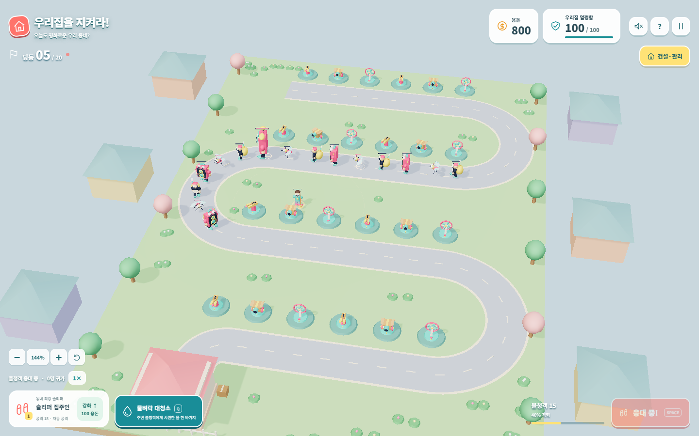

# 경계선: 최후의 전초기지

React + TypeScript + Three.js + Vite로 만든 3D 전초기지 디펜스입니다. 지휘관을 직접 이동시키고 포탑을 배치해 20번의 공세를 저지합니다. 부대·포탑·기지와 UI를 군사 작전 콘셉트로 통일했습니다. Kenney CC0 캐릭터에 헬멧·장비를 더하고, 배경은 야전 텐트·막사·감시탑·철조망·모래주머니·장갑차·보급 차량·탄흔과 그루터기로 구성합니다. 일반 주택·가로수·전봇대는 사용하지 않습니다.

## 실행과 검증

Node.js 22.12 이상 또는 24 LTS가 필요합니다.

```sh
npm ci
npm run dev
npm test
npm run build
npm run preview
```

개발 서버 주소는 실행 출력에 표시됩니다. 같은 Wi-Fi의 모바일에서는 개발 PC의 LAN 주소를 사용하세요.

## 플레이

- S자 도로와 18개 건설 부지에서 방어합니다. 기존 아래쪽 세 직선 도로의 좌표를 유지합니다.
- PC는 WASD / 방향키로 지휘관 이동, Q 지원 포격, SPACE 웨이브 시작, P 일시정지입니다. 지휘관은 사거리 안의 적을 자동 사격합니다.
- 드래그로 화면 이동, 휠 또는 모바일 핀치로 확대·축소합니다. 카메라는 회전하지 않습니다. 확대 범위는 100~500%, 모바일 기본은 170%이며 화면에는 배율을 표시하지 않습니다. 하단 지휘 패널의 시점 초기화로 기본 시점으로 돌아갑니다.
- 모바일은 왼쪽 조이스틱으로 지휘관을 이동합니다. 드래그·핀치로 건설 부지가 잘못 선택되지 않습니다.
- 빈 부지를 누르면 기관포(70)·박격포(110)·냉각포(95)를 건설합니다. 건설한 포탑을 누르면 강화·전문화·판매가 표시됩니다. 포탑은 최대 Lv.5, 지휘관은 Lv.10입니다.
- Lv.3 포탑은 무료로 전문화합니다. 기관포는 관통탄/속사 장치, 박격포는 확산 포탄/소이탄, 냉각포는 심층 냉각/취약 표식 중 하나를 고릅니다. 선택 후 변경할 수 없으며, 판매 시 투자 자원의 75%를 회수합니다.
- 하단에는 지원 포격·1×/2× 배속·웨이브 시작·지휘 패널을 모았습니다. 수리, 지휘관 강화, 일시정지, 소리, 조작 안내, 새 작전은 접이식 지휘 패널에서 사용합니다. 건설·지휘 패널을 열어도 전투는 계속 진행됩니다. 지휘 패널의 부지 선택은 키보드로도 사용할 수 있습니다.
- 시작 자원은 300입니다. 일반/정찰/중장갑 처치 보상은 14/16/24, 보스는 160+웨이브×4, 웨이브 완료 보상은 80+웨이브×10입니다.
- 군집·고속·장갑·복합·보스 공세가 순환하고 5웨이브마다 병력이 늘어납니다. 첫 다섯 웨이브 적 수는 24/30/38/46/60이며 동시 생존 적은 최대 32기입니다. 5·10·15·20웨이브의 마지막 적은 보스입니다.
- 3·6·9·12·15·18웨이브 완료 후 전술 3개 중 하나를 고릅니다. 공격 속도·보급·폭발·냉각·긴급 보급·현장 지휘를 조합할 수 있고 같은 전술은 최대 3회 선택합니다. 선택지는 작전마다 달라지고 저장 후 재접속해도 유지됩니다.
- Easy/Normal/Hard의 적 체력은 기존 난이도 대비 각각 2/4/8배(기본 배율 2/5.6/16)입니다. 추가 웨이브별 체력 성장은 0/4/8%, 이동 속도는 기존 대비 1/1.08/1.15배입니다. 냉각포의 감속은 기본 40%, 심층 냉각 60%이며 처치 보상·건설·강화 비용은 유지합니다. 최종 재미와 난이도는 실제 플레이 피드백에 맞춰 조정할 수 있습니다.
- 진행은 브라우저에 2초마다 자동 저장합니다. 탭을 숨기면 일시정지합니다. 저장 버전 1~4를 버전 5로 변환하며 기존 자원·웨이브·강화를 유지합니다. 이전 지도에서 제거된 6개 부지의 포탑은 당시 구매·강화 비용을 전액 환급합니다. 전술 선택과 전문화도 저장됩니다. 브라우저 데이터를 지우면 저장도 지워집니다.



## 구성과 렌더링

규칙·저장 변환은 `src/game.ts`, 공유 지도는 `src/battlefield.ts`, 화면·조작은 `src/main.tsx`, 카메라 제스처는 `src/camera-controls.ts`, 지형·전투 연출은 `src/world.ts`, 주변 배경은 `src/neighborhood.ts`, 자체 모델은 `src/world-models.ts`, GLB 로딩·애니메이션·공유 자원은 `src/resident-models.ts`, GPU 입자는 `src/world-particles.ts`입니다.

지형은 재질별로 병합하고 캐릭터는 스킨 메시를 사용하며 전투 입자는 고정 GPU 버퍼를 재사용합니다. 기기 픽셀 비율은 최대 3, 전체 300만 픽셀을 상한으로 두고 후처리 버퍼에 최대 4× MSAA를 적용합니다. 그림자 맵은 2048이며 갱신은 최대 30Hz입니다. 모바일은 SSAO·블룸을 끄고 선명도에 렌더링 비용을 우선 배분합니다. WebGL을 지원하는 최신 브라우저가 필요합니다.

Kenney Mini Characters의 CC0 모델·텍스처·라이선스를 `public/models`에 포함합니다. 스켈레톤은 개별 복제하고 메시·재질은 공유합니다. 기존 주택 모델 파일은 보관하지만 로딩·표시하지 않습니다. 모델을 읽지 못하면 자체 모델로 계속 플레이합니다. 유료 에셋은 포함하지 않습니다. Google Fonts 연결이 안 되면 시스템 폰트로 표시됩니다.

## 배포

Vercel Framework **Vite**, Build **npm run build**, Output **dist**. 저장소의 `vercel.json`에 설정되어 있습니다. 별도 입장 코드 없이 배포 주소로 플레이할 수 있습니다.
